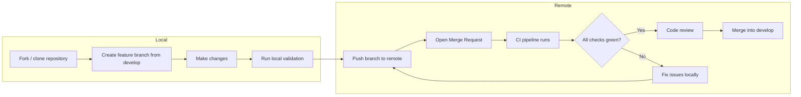
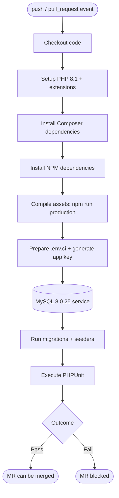
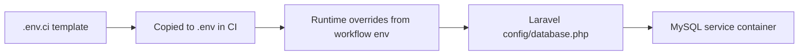
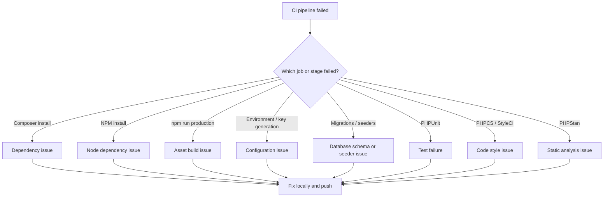

# LibreHealth EHR — CI/CD Pipeline & Merge Request Guide

> **Audience:** Contributors, reviewers, and maintainers.
> **Goal:** Explain how code moves from a local branch to a merged contribution, what the CI pipeline validates, and how to unblock a failing merge request (MR).

---

## Table of Contents

1. [Overview](#1-overview)
2. [Repository CI/CD Layout](#2-repository-cicd-layout)
3. [Contribution Model](#3-contribution-model)
4. [CI/CD Pipeline Deep Dive](#4-cicd-pipeline-deep-dive)
5. [MU Workflow Security Tests](#5-mu-workflow-security-tests)
6. [Code Quality & Static Analysis](#6-code-quality--static-analysis)
7. [Local Development Environment](#7-local-development-environment)
8. [Troubleshooting Guide](#8-troubleshooting-guide)
9. [Best Practices](#9-best-practices)
10. [Appendices](#10-appendices)

---

## 1. Overview

LibreHealth EHR uses a **continuous integration (CI)** pipeline to validate every change before it is merged. The pipeline is defined in [`.github/workflows/run-tests.yml`](../.github/workflows/run-tests.yml) and runs on GitHub Actions. It is triggered on every `push` and every `pull_request` event.

Because the canonical repository is hosted on **GitLab**, the day-to-day collaboration unit is a **Merge Request (MR)**. The concepts are identical to a GitHub Pull Request (PR): a request to merge a feature branch into the target branch (usually `develop`).

### Key principles

1. **The pipeline is the gatekeeper.** A red pipeline blocks merging.
2. **Reproduce locally first.** If a job fails in CI, it should be reproducible on your machine.
3. **Small, focused changes.** Smaller MRs are easier to review and less likely to conflict with other work.
4. **Code quality is enforced.** Style, static analysis, and tests must all pass.

---

## 2. Repository CI/CD Layout

The following files control how code is built, tested, and validated.

| File | Purpose |
|------|---------|
| [`.github/workflows/run-tests.yml`](../.github/workflows/run-tests.yml) | Main CI pipeline (GitHub Actions). |
| [`.env.ci`](../.env.ci) | Environment template used by CI. |
| [`phpcs.xml`](../phpcs.xml) | PHP CodeSniffer rules (PSR-2). |
| [`phpstan.neon.dist`](../phpstan.neon.dist) | PHPStan / Larastan static analysis configuration. |
| [`.styleci.yml`](../.styleci.yml) | StyleCI configuration for automated style fixes. |
| [`.githooks/pre-commit`](../.githooks/pre-commit) | Local pre-commit hook that runs PHPCS on staged PHP files. |
| [`phpunit.xml`](../phpunit.xml) | PHPUnit test suite and environment configuration. |
| [`composer.json`](../composer.json) | PHP dependencies and composer scripts. |
| [`package.json`](../package.json) | Node dependencies and asset build scripts. |

---

## 3. Contribution Model

### 3.1 High-level workflow



### 3.2 Branching strategy

- **Default branch:** `develop`
- **Create your branch from:** `develop`
- **Branch naming conventions:**
  - `feature/<short-description>` — new functionality
  - `fix/<short-description>` — bug fixes
  - `chore/<short-description>` — maintenance, dependency updates
  - `docs/<short-description>` — documentation changes

Example:

```bash
git checkout develop
git pull origin develop
git checkout -b feature/add-patient-search
```

### 3.3 Commit conventions

- Start the subject line with a capital letter.
- Use the imperative mood: `Add patient search`, not `Added patient search`.
- Keep the subject under 72 characters.
- Add a body when the change needs explanation.

Example:

```text
Add patient search by name and MRN

Implements a scoped search that filters patients by name or medical
record number. Includes unit and feature tests.

Closes #123
```

### 3.4 Merge Request lifecycle

1. **Open the MR early** as a draft if you want early feedback.
2. **Fill in the description.** Explain what changed, why, and how to test it.
3. **Ensure the pipeline is green.** A red pipeline blocks review and merge.
4. **Respond to review comments.** Push fixes as new commits or amend/squash if the project requires a clean history.
5. **Rebase on `develop`** if the branch falls behind to resolve conflicts and keep history linear.

---

## 4. CI/CD Pipeline Deep Dive

### 4.1 Trigger events

The workflow runs on:

```yaml
on: [push, pull_request]
```

This means every commit pushed to any branch, and every pull/merge request, starts the pipeline.

### 4.2 Pipeline architecture



### 4.3 Job matrix

The workflow uses a single job named `test` with the following matrix:

| Dimension | Value |
|-----------|-------|
| Operating system | `ubuntu-latest` |
| PHP version | `8.1` |
| Dependency strategy | `prefer-stable` |

`fail-fast: false` is enabled so that all matrix combinations run even if one fails.

### 4.4 Service dependencies

The job depends on a MySQL service container:

```yaml
services:
  mysql:
    image: mysql:8.0.25
    env:
      MYSQL_ROOT_PASSWORD: passw0rd
      MYSQL_DATABASE: lh_ehr
    ports:
      - 33306:3306
    options: --health-cmd="mysqladmin ping" --health-interval=10s --health-timeout=5s --health-retries=3
```

GitHub Actions maps container port `3306` to host port `33306`. The application connects through the mapped port.

### 4.5 Stage-by-stage breakdown

#### Stage 1 — Checkout code

- **Action:** `actions/checkout@v3`
- **Purpose:** Clone the exact commit that triggered the workflow.

#### Stage 2 — Setup PHP

- **Action:** `shivammathur/setup-php@v2`
- **PHP version:** `8.1`
- **Extensions installed:**
  `dom, curl, libxml, mbstring, zip, pcntl, pdo, sqlite, pdo_sqlite, bcmath, soap, intl, gd, exif, iconv, imagick, fileinfo`
- **Coverage:** disabled (`none`) for faster runs.

#### Stage 3 — Install Composer dependencies

```bash
composer install -q --no-ansi --no-interaction --no-scripts --no-suggest --no-progress --prefer-dist
```

- `--no-scripts` skips composer scripts during install to avoid bootstrapping Laravel in CI prematurely.
- `--prefer-dist` downloads distribution packages (faster than source installs).

#### Stage 4 — Install NPM dependencies

```bash
npm install
```

Installs the Node packages defined in `package.json`, including Laravel Mix, Vue 2, Tailwind CSS, and build tooling.

#### Stage 5 — Compile assets

```bash
npm run production
```

Runs Laravel Mix in production mode. This validates that:

- SASS compiles without errors.
- Vue single-file components parse correctly.
- Tailwind CSS is generated.
- Dynamic imports and vendor chunks can be built.

#### Stage 6 — Environment setup

```bash
cp .env.ci .env
composer clear-all
php artisan key:generate
```

Environment variables at this stage:

| Variable | Value |
|----------|-------|
| `DB_CONNECTION` | `mysql` |
| `DB_DATABASE` | `lh_ehr` |
| `DB_PORT` | dynamic mapped MySQL port |
| `DB_USER` | `root` |
| `DB_PASSWORD` | `passw0rd` |

`composer clear-all` is a custom script that clears and rebuilds caches:

```bash
php artisan clear-compiled
php artisan cache:clear
php artisan route:clear
php artisan view:clear
php artisan config:clear
php artisan route:cache
php artisan config:cache
composer dumpautoload -o
```

#### Stage 7 — Database setup

```bash
php artisan migrate --force
yes | php artisan db:seed
```

- `--force` allows migrations to run in a non-interactive environment.
- `yes | php artisan db:seed` confirms the seeder prompt automatically.

This stage proves that:

- All migration files are syntactically valid.
- Migrations can run against MySQL 8.
- Seeders can populate the database without errors.

#### Stage 8 — Run tests

```bash
vendor/bin/phpunit
```

PHPUnit reads `phpunit.xml`, which defines:

- **Unit suite:** `tests/Unit`
- **Feature suite:** `tests/Feature`
- **Code coverage source:** `app/`
- **Test environment variables:**
  - `APP_ENV=testing`
  - `CACHE_DRIVER=array`
  - `QUEUE_CONNECTION=sync`
  - `SESSION_DRIVER=array`
  - `DB_CONNECTION=mysql` (overridden by CI env)

### 4.6 Important CI/environment notes

| Topic | Current state | Contributor impact |
|-------|---------------|--------------------|
| **PHP version in CI** | `8.1` | Write code that runs on PHP `8.1`. Avoid PHP `8.2+`-only syntax even though `composer.json` requires `^8.2`. |
| **PHP version in `composer.json`** | `^8.2` | Local development may use PHP `8.2`. Verify CI compatibility before opening an MR. |
| **README requirement** | `8.0.x+` | Documentation is slightly behind; treat CI (`8.1`) as the authoritative runtime. |
| **Database driver** | MySQL `8.0.25` | Test database changes locally with MySQL, not only SQLite. |
| **Test database** | CI uses `lh_ehr`; local PHPUnit uses `lh_ehr_testing` | Make sure both databases can be migrated and seeded. |
| **Asset build mode** | Production | The pipeline builds minified assets. Any build error blocks the MR. |

### 4.7 Environment variable flow



---

## 5. MU Workflow Security Tests

> **Context:** This section describes the security test suite that validates Meaningful Use (MU) workflows. The suite is being developed on the `feature/mu-workflow-security-tests` branch and will extend the pipeline once merged into `develop`.

### 5.1 What are MU workflow security tests?

Meaningful Use (MU) workflows are the end-to-end clinical and administrative flows in an EHR — patient registration, appointment scheduling, clinical documentation, data exchange, reporting, and user management. Because these workflows handle protected health information (PHI), they must be hardened against common web vulnerabilities.

The MU workflow security test suite is a dedicated PHPUnit test suite that exercises these workflows from a security perspective:

- **Authentication** — routes require authentication.
- **Authorization / role-based access control** — users can only access data and actions permitted by their role.
- **Input validation** — XSS payloads are sanitized or rejected.
- **SQL injection resistance** — malicious input does not alter queries.
- **Audit logging** — sensitive actions are recorded.
- **Privacy** — users cannot view or modify other users' patients or appointments.

### 5.2 Test structure

```text
tests/
├── SecurityTestCase.php                 # Shared base class for all security tests
└── Feature/Security/
    ├── AdminAccessSecurityTest.php
    ├── AuditLogSecurityTest.php
    ├── AuthSecurityTest.php
    ├── CalendarAppointmentSecurityTest.php
    ├── ClinicalDataExchangeSecurityTest.php
    ├── ClinicalDecisionSupportAppointmentSecurityTest.php
    ├── DashboardAccessSecurityTest.php
    ├── FacilityReportingSecurityTest.php
    ├── FacilitySecurityTest.php
    ├── PatientAccessSecurityTest.php
    ├── PatientDataTableSecurityTest.php
    ├── PatientRegistrationSecurityTest.php
    ├── PatientReportingSecurityTest.php
    ├── PrivacySecurityTest.php
    ├── SecurityTestFoundationTest.php
    └── UserManagementSecurityTest.php
```

The base class, `SecurityTestCase`, provides:

- Pre-loaded test users for each role (`super_admin`, `admin`, `clinician`, `nurse`, `front_desk`, `patient_user`).
- Common XSS and SQL injection payloads.
- Helper assertions such as `assertRouteRequiresAuth()`.
- A seeded test database via `SecurityTestSeeder`.

### 5.3 How it integrates with the pipeline

When the security suite is merged, `phpunit.xml` gains an additional test suite:

```xml
<testsuite name="Security">
    <directory suffix="Test.php">./tests/Feature/Security</directory>
</testsuite>
```

The existing CI command `vendor/bin/phpunit` will automatically discover and run the Security suite alongside Unit and Feature tests. No separate workflow job is required.

### 5.4 Running the security suite locally

```bash
# Ensure the test database exists and is migrated
mysql -u root -p -e "CREATE DATABASE IF NOT EXISTS lh_ehr_testing;"

# The security suite uses its own seeder
php artisan migrate --database=lh_ehr_testing

# Run only the security tests
vendor/bin/phpunit --testsuite Security

# Or run a single security test
vendor/bin/phpunit tests/Feature/Security/AuthSecurityTest.php
```

### 5.5 What to do if a security test fails

1. Read the failure message to identify the route, role, and vulnerability being tested.
2. Reproduce the request manually or with a focused PHPUnit run.
3. Apply the fix in the application code (controller, policy, middleware, or form request).
4. Re-run the failing test and the full security suite before pushing.

---

## 6. Code Quality & Static Analysis

In addition to the GitHub Actions workflow, the project uses several quality gates.

### 6.1 PHP CodeSniffer (PHPCS)

- **Standard:** PSR-2
- **Configuration:** `phpcs.xml`
- **Scope:** `app/`, `bootstrap/`, `config/`, `resources/`, `routes/`, `Modules/`
- **Excluded paths:** cache, migrations, seeds, Blade views, JavaScript, vendor, database, storage, node_modules.

Run manually:

```bash
./vendor/bin/phpcs --standard=phpcs.xml app/Http/Controllers/MyController.php
```

Auto-fix:

```bash
./vendor/bin/phpcbf --standard=phpcs.xml app/Http/Controllers/MyController.php
```

### 6.2 PHPStan / Larastan

- **Level:** `5`
- **Configuration:** `phpstan.neon.dist`
- **Scope:** `app/`, `config/`, `routes/`
- **Extension:** `larastan/larastan`

Run manually:

```bash
./vendor/bin/phpstan analyse --configuration=phpstan.neon.dist
```

### 6.3 StyleCI

- **Preset:** Laravel
- **Disabled rule:** `unused_use`
- **Configuration:** `.styleci.yml`

StyleCI can open automated fixes for style violations.

### 6.4 Pre-commit hook

The repository provides a Git hook in `.githooks/pre-commit` that runs PHPCS on staged PHP files.

Enable it:

```bash
git config core.hooksPath .githooks
```

If the hook fails, the commit is rejected until the style issue is fixed.

---

## 7. Local Development Environment

### 7.1 Requirements

- PHP `8.1` or higher (matching CI is recommended).
- Composer `2.0+`.
- Node.js and NPM.
- MySQL `5.7.8+` / MariaDB `10.3.2+` / PostgreSQL.
- Redis `3.0+` (for queues/cache if not using array driver).

### 7.2 Required PHP extensions

```text
bz2, curl, date, dom, exif, gd, gettext, grpc,
imagick, intl, json, libxml, mbstring, mysqli, mysqlnd, openssl, pcntl, PDO,
pdo_mysql, posix, protobuf, redis, soap, sqlite3, xml, xmlreader, xmlwriter,
xsl, zip, zlib
```

### 7.3 Step-by-step local setup

```bash
# 1. Clone the repository
git clone https://github.com/LibreHealthIO/lh-ehr-laravel.git
cd lh-ehr-laravel

# 2. Install PHP dependencies
composer install --prefer-dist

# 3. Install Node dependencies
npm install

# 4. Environment setup
cp .env.example .env
php artisan key:generate

# 5. Configure your database in .env
# DB_CONNECTION=mysql
# DB_HOST=127.0.0.1
# DB_PORT=3306
# DB_DATABASE=lh_ehr
# DB_USERNAME=root
# DB_PASSWORD=your_password

# 6. Run migrations and seeders
php artisan migrate --seed

# 7. Compile assets
npm run dev        # development build
# OR
npm run production # production build (matches CI)

# 8. Start the development server
php artisan serve
```

### 7.4 Test database setup

Create a dedicated test database:

```bash
mysql -u root -p -e "CREATE DATABASE IF NOT EXISTS lh_ehr_testing;"
```

Create `.env.testing`:

```bash
cp .env.example .env.testing
```

Edit `.env.testing`:

```env
TEST_DB_HOST=127.0.0.1
TEST_DB_DATABASE=lh_ehr_testing
TEST_DB_USERNAME=root
TEST_DB_PASSWORD=
```

Run migrations and seeders on the test connection:

```bash
php artisan migrate --database=lh_ehr_testing
php artisan db:seed --database=lh_ehr_testing
```

Run the test suite:

```bash
vendor/bin/phpunit
```

### 7.5 Running the full CI pipeline locally

To approximate CI on your machine:

```bash
# Clean install
rm -rf vendor composer.lock node_modules package-lock.json
composer install --prefer-dist
npm install

# Build assets
npm run production

# Setup environment
cp .env.ci .env
composer clear-all
php artisan key:generate

# Setup database (ensure MySQL is running and lh_ehr exists)
php artisan migrate:fresh --seed

# Run tests
vendor/bin/phpunit

# Run quality gates
./vendor/bin/phpcs --standard=phpcs.xml
./vendor/bin/phpstan analyse --configuration=phpstan.neon.dist
```

---

## 8. Troubleshooting Guide

### 8.1 Decision tree



### 8.2 Failure symptom matrix

| Symptom | Likely cause | Resolution |
|---------|--------------|------------|
| `composer install` fails with PHP version error | Local PHP version differs from dependency requirements | Switch to PHP `8.1` or `8.2`; update `composer.lock` only if intended. |
| `npm install` fails | Node version incompatibility or stale lock file | Delete `node_modules` and `package-lock.json`, then reinstall. |
| `npm run production` fails | SASS/Vue/PostCSS syntax error | Read the error line, fix the syntax, and rebuild. |
| `php artisan key:generate` fails | Missing `.env` or writable permissions | Copy `.env.ci` to `.env` and ensure the file is writable. |
| Migrations fail | Invalid SQL, missing table, or conflicting migration | Run `php artisan migrate:fresh --seed` locally and fix the failing migration. |
| Seeders fail | Foreign key violation or missing dependency data | Check seeder order and ensure referenced data exists. |
| PHPUnit fails | Logic bug, missing test DB, or changed behavior | Run `vendor/bin/phpunit` locally and fix the failing test or code. |
| PHPCS fails | Style violations | Run `./vendor/bin/phpcbf` to auto-fix, then re-run `./vendor/bin/phpcs`. |
| PHPStan fails | Type errors or undefined methods | Add type hints, docblocks, or fix the underlying logic. |
| StyleCI fails | Automated style fix available | Apply the StyleCI patch or run the equivalent local formatter. |

### 8.3 How to read CI logs

1. Open the failing workflow run.
2. Expand the failed job (`test`).
3. Click the failed step.
4. Read from the **bottom up** to find the error message.
5. Scroll up for context (which file, which line, which command produced the error).

### 8.4 Common gotchas

- **MySQL port mapping:** CI uses `DB_PORT=33306` on the host, not `3306`.
- **`DB_USER` vs `DB_USERNAME`:** The CI workflow exports `DB_USER`, but Laravel reads `DB_USERNAME`. The CI values work because Laravel falls back to defaults or because the application uses `DB_USER` directly in some places. When reproducing locally, set `DB_USERNAME` in `.env`.
- **`--no-scripts` in CI:** Composer scripts are skipped during install. If your change relies on a composer script, it will not run in CI during the install step.
- **Seeded database for tests:** PHPUnit runs after migrations and seeders. Tests must either tolerate seeded data or reset state in `setUp`.

### 8.5 Escalation path

If you cannot resolve a CI failure:

1. Re-run the failed job to rule out transient issues.
2. Paste the relevant error snippet and job link as a comment on your MR.
3. Tag a maintainer for help.
4. Open a draft MR early if you need CI feedback while developing.

---

## 9. Best Practices

### Before opening an MR

- [ ] Branch is up to date with `develop`.
- [ ] `composer install --prefer-dist` succeeds.
- [ ] `npm install` succeeds.
- [ ] `npm run production` succeeds.
- [ ] `php artisan migrate:fresh --seed` succeeds on a local MySQL database.
- [ ] `vendor/bin/phpunit` passes.
- [ ] `./vendor/bin/phpcs --standard=phpcs.xml <changed-files>` passes.
- [ ] `./vendor/bin/phpstan analyse --configuration=phpstan.neon.dist` passes if you changed PHP files in `app/`, `config/`, or `routes/`.
- [ ] Pre-commit hook is enabled (`git config core.hooksPath .githooks`).
- [ ] Commit messages are clear and descriptive.
- [ ] MR description explains what, why, and how to test.

### During review

- Respond to comments promptly.
- Push fixes as separate commits for clarity; squash only if requested.
- Keep the pipeline green after every push.

### After merge

- Delete the feature branch.
- Update or close related issues.
- Monitor the `develop` branch pipeline for any post-merge failures.

---

## 10. Appendices

### Appendix A — CI environment reference

| Setting | Value |
|---------|-------|
| Platform | GitHub Actions |
| Runner | `ubuntu-latest` |
| Trigger | `push`, `pull_request` |
| PHP | `8.1` |
| Dependency mode | `prefer-stable` |
| MySQL image | `mysql:8.0.25` |
| MySQL root password | `passw0rd` |
| MySQL database | `lh_ehr` |
| MySQL host port | `33306` |
| MySQL container port | `3306` |

### Appendix B — Useful commands

```bash
# Local setup
composer install --prefer-dist
npm install
cp .env.example .env
php artisan key:generate
php artisan migrate --seed
npm run production

# Testing
vendor/bin/phpunit
vendor/bin/phpunit --filter MyTest

# Code quality
./vendor/bin/phpcs --standard=phpcs.xml app/Http/Controllers/MyController.php
./vendor/bin/phpcbf --standard=phpcs.xml app/Http/Controllers/MyController.php
./vendor/bin/phpstan analyse --configuration=phpstan.neon.dist

# Caching
composer clear-all
composer cache-all

# Git hooks
git config core.hooksPath .githooks
```

### Appendix C — Glossary

| Term | Meaning |
|------|---------|
| **CI** | Continuous Integration — automated builds and tests on every change. |
| **MR** | Merge Request — a GitLab request to merge one branch into another. |
| **PR** | Pull Request — a GitHub request to merge one branch into another. |
| **PHPCS** | PHP CodeSniffer — tool for detecting coding standard violations. |
| **PHPCBF** | PHP Code Beautifier and Fixer — auto-fixes many PHPCS violations. |
| **PHPStan** | Static analysis tool for PHP. |
| **Larastan** | PHPStan extension for Laravel-specific analysis. |
| **StyleCI** | Automated code style review and fixing service. |
| **Laravel Mix** | Wrapper around Webpack for compiling front-end assets. |
| **Seeder** | Class that populates the database with sample or required data. |

---

Thank you for contributing to LibreHealth EHR. Keeping the pipeline green helps us ship reliable, high-quality code for healthcare providers around the world.
